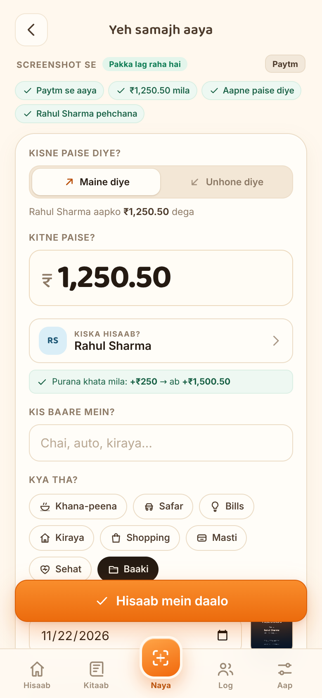
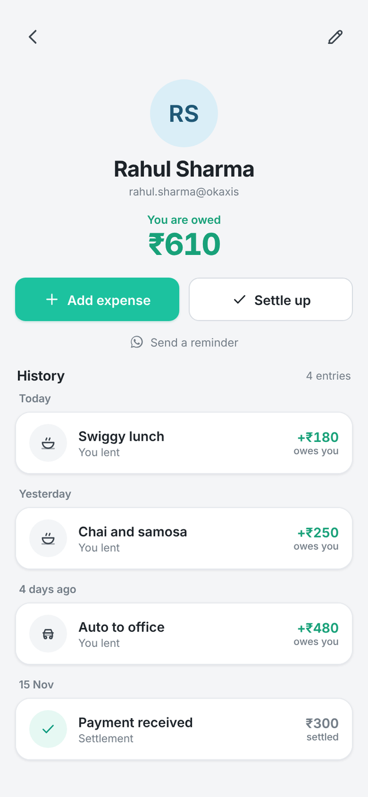

# HisaabKitaab

**अपना हिसाब, अपनी ज़ुबानी** — a warm, Indian, one-tap-install app for keeping money straight with friends, family and dukaandaars.

Bhejo screenshot, chat ya bank SMS — naam, amount aur kisne diya, sab khud samajh jaata hai. Purana khata milta hai toh usi mein add, naya banda ho toh naya khata khud ban jaata hai.

Built as an installable PWA: **one link, works on iPhone and Android**, no Play Store, no App Store, no login. Everything stays on the phone.

## Open the app

**<https://hisaabkitaab-app.deed.page/>**

<p align="center">
  <a href="https://hisaabkitaab-app.deed.page/"></a>
</p>

On **Android**, open the link and tap **Install** in the app's banner (or ⋮ → Install app). On **iPhone/iPad**, open it in Safari → **Share** → **Add to Home Screen**. After that it opens full-screen, works offline, and keeps all data on the phone.

> The free public hosting shows a small “Published with deed.page” badge below the app's controls. It does not cover the app or affect installing/offline use.

<p align="center">
  
  
  
</p>

---

## What it does

### 1. Smart add from a screenshot, chat or SMS
- **Screenshot OCR runs on-device** (Tesseract WASM). Dark-mode UPI screenshots are auto-inverted and upscaled before reading.
- Understands **GPay, PhonePe, Paytm, BHIM, Amazon Pay, bank SMS** and normal **WhatsApp/Hinglish** messages:
  - `You paid ₹250 to Rahul Sharma`, `Paid to Rahul Sharma ₹250`
  - `Rs.1,200 debited ... to VPA rahul@okaxis (RAHUL SHARMA). Avl Bal ₹8,420`
  - `Priya Verma paid you ₹1,500`
  - `Maine Rahul ko auto ke liye 90 rupaye diye`
  - `Rahul ko 500 diye kal`, `Rahul Sharma ne kiraya ₹11,000 diya`
- Extracts **amount, direction (diye / liye), person, UPI ID, date and category**, and ignores UPI refs, account numbers, balances and phone numbers.
- Shows what it understood — with confidence and reasons — and lets you fix **everything** before saving. Nothing is saved silently.

### 2. Automatic khata, the way you described it
- If the person already has a khata, it is **matched by name / alias / UPI** and the entry is added to the same balance.
- If they are new, a **new khata is created with their name** immediately.
- Balance maths is always net:

  | Kya hua | Balance |
  | --- | --- |
  | Maine unko paise diye | **+** (woh mujhe denge) |
  | Unhone mujhe paise diye | **−** (main unko dunga) |
  | Settlement | zero ho jaata hai |

- The review screen shows the old balance → new balance before you save, and the success screen tells you exactly who owes whom after saving.

### 3. The rest of a proper hisaab app
- Home: total milna / dena, per-person balances, recent activity.
- Person khata: full timeline, add / edit / delete entries, **settle up**, offline.
- WhatsApp reminders in polite Hinglish (you can read before sending).
- Categories with an Indian flavour: Khana-peena, Safar, Bills, Kiraya, Shopping, Masti, Sehat.
- Search, filters, monthly totals.
- Backup / restore as a JSON file, sample data mode, reset.
- Works **offline** after first load (service worker + runtime caching).
- Installable: Android install prompt and iPhone “Add to Home Screen”.

---

## Install it like an app (one tap)

The live app is already deployed. To run your own copy, deploy the built `dist/` folder to any HTTPS static host (Netlify, Vercel, Cloudflare Pages, GitHub Pages, S3), then:

- **Android (Chrome)** → open the link → tap **Install** in the in-app banner, or menu **⋮ → Install app**.
- **iPhone / iPad (Safari)** → open the link → **Share** → **Add to Home Screen**.
- On Android you can also **share a payment screenshot directly to HisaabKitaab** from the share sheet. The app opens with the screenshot already read.

> Use HTTPS. Service worker, install prompt and share-target all require a secure origin (`localhost` is fine for development).

### Optional: a real APK
The same codebase can be wrapped with Capacitor. A manual GitHub Actions workflow is included:

1. Push this repo to GitHub.
2. **Actions → Build Android APK → Run workflow**.
3. Download the `app-debug.apk` artifact and install it (enable “install unknown apps” once).

The PWA link remains the recommended one-tap path: it updates instantly, supports the Android share sheet, and needs no APK.

---

## Run locally

```bash
npm install          # also copies the OCR engine into public/ocr
npm run dev          # http://localhost:5173
npm run build        # production build in dist/
npm run preview      # serve the production build
```

Tests:

```bash
npm run test:parser  # 20+ real-world payment/chat strings → parser assertions
npm run test         # jsdom + Testing Library flows (onboarding, smart add, settle, manual entry)
```

OCR assets are generated (not committed) by `scripts/prepare-ocr.mjs`, which runs on `postinstall` and before every build.

---

## How the smart parsing works

No server, no API key, no data leaves the device.

1. **OCR** — Tesseract.js (WASM) with English `tessdata_best` int model. The worker, WASM cores and model are served from the app itself. Dark screenshots are inverted; large images are capped at 1800px for speed.
2. **Amount** — currency-marked numbers first (`₹`, `Rs`, `INR`, `rupees`, `rupaye`), scored by proximity to direction words and rejected when they look like account numbers, refs, balances, phone numbers or dates.
3. **Direction** — weighted regex rules for English and Hinglish grammar (`paid to`, `debited`, `received from`, `maine … diye`, `ne … diya`, …), with a label-based fallback.
4. **Person** — label capture (`Paid to`, `From`, `VPA … (NAME)`), UPI local-part hints, chat prefixes and standalone name lines; then fuzzy matching (token overlap, containment, aliases, UPI) against existing people.
5. **Confidence** — combines amount/person/direction/date signals; the UI explains the guess and asks for review.

This is deliberately rule-based: fast, offline, deterministic and free. Every draft is editable, so imperfect OCR is never a dead end.

---

## Privacy

- Transactions, people and settings live in `localStorage` on your device.
- Screenshot OCR happens in your browser. Nothing is uploaded anywhere.
- No analytics, no accounts, no tracking, no third-party runtime calls.
- Export a backup before clearing browser data.

---

## Stack

- React 19 + TypeScript + Vite
- Hand-written CSS design system (Baloo 2 + Inter, self-hosted)
- Tesseract.js 7 (on-device OCR) with local `eng` model
- PWA: manifest, service worker, Android share target, offline shell
- Indexed/fuzzy matching + rule-based transaction parser (`src/lib/parse.ts`)
- Vitest + Testing Library
- Optional Capacitor Android wrapper + GitHub Actions APK build

### Project layout

```
src/
  lib/
    parse.ts      # Indian payment / chat parser + person matching
    ocr.ts        # local Tesseract worker + image preprocessing
    store.tsx     # app state, persistence, transactions
    calc.ts       # balances, grouping
    share.ts      # share-target inbox, WhatsApp reminders, backup
    router.ts     # tiny hash router
  components/     # avatars, sheets, person picker, rows, icons
  pages/          # Home, Scan (smart add), Person, People, Activity, Settings, Onboarding
public/
  manifest.json
  sw.js           # offline shell + share-target handler
  icons/
scripts/          # OCR asset prep, icon generation, parser tests
```

---

## Known limits (honest list)

- OCR accuracy depends on the screenshot; very blurry / heavily cropped images may need a manual nudge. Hindi OCR is not enabled to keep the download small — Hinglish written in Latin script is well supported.
- iPhone does not support the PWA share sheet; use the in-app “Gallery se chuno” (latest screenshot is one tap away).
- The APK workflow produces a **debug** APK. A Play Store build needs your own signing key and a privacy policy.
- Different balances for the same person across two phones are not synced — this is local-first by design. Move data with the JSON backup.

---

Made for real Indian hisaab — chai se kiraya tak. 🇮🇳
