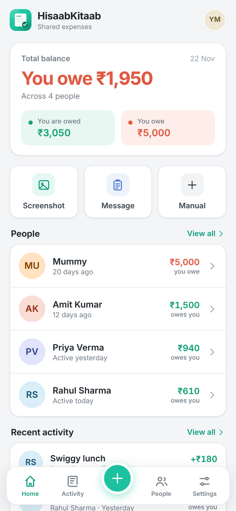

# HisaabKitaab

**A calm, private ledger for shared expenses.**

HisaabKitaab keeps everyday shared spending straight: who paid, who owes, and what is left to settle. Add an expense from a payment screenshot, a message, or by hand — the app reads the details, matches the person, and updates the balance. No account, no server, no app store.

It installs from a link and works on iPhone, Android and the web.

<p align="center">
  <a href="https://hisaabkitaab-app-2.deed.page/"></a>
</p>

### Open the app

**<https://hisaabkitaab-app-2.deed.page/>**

<p align="center">
  
  
  
</p>

On **Android**, open the link and tap **Install** in the app's banner (or ⋮ → **Install app**). On **iPhone/iPad**, open it in Safari → **Share** → **Add to Home Screen**. After that it opens full-screen, works offline, and keeps all data on the phone.

> The free public hosting shows a small “Published with deed.page” badge below the app's controls. It does not cover the app or affect installing/offline use.

---

## What it does

### 1. Add an entry in seconds

- **Screenshot OCR runs on the device** using Tesseract.js (WebAssembly). Dark-mode UPI receipts are auto-inverted and upscaled, and the reader tries more than one pass when the first one looks uncertain.
- Works with **GPay, PhonePe, Paytm, BHIM, Amazon Pay and bank messages**, plus plain **English and Hinglish** chat text:
  - `You paid ₹250 to Rahul Sharma`
  - `Paid to Rahul Sharma ₹250`
  - `₹1,200 debited ... to VPA rahul@okaxis (RAHUL SHARMA). Avl Bal ₹8,420`
  - `Priya Verma paid you ₹1,500`
  - `Maine Rahul ko auto ke liye 90 rupaye diye`
- Extracts the **amount, direction, person, UPI ID, date and category**, while ignoring UPI references, account numbers, balances, phone numbers and dates that look like amounts.
- **Knows which way the money moved.** If a receipt shows a payment made *to you*, the entry is recorded as money received, and the app asks who sent it so the balance goes to the right person. It never creates a contact from your own name.
- Shows what it understood — amount, direction, person, confidence and the extracted text — and lets you correct **everything** before saving. Nothing is saved silently.

### 2. A ledger that stays in balance

- Existing people are matched by **name, alias or UPI ID**; a new person is created when the name is new.
- Balances are always net:

  | What happened | Balance |
  | --- | --- |
  | You paid for them | **+** they owe you |
  | They paid for you | **−** you owe them |
  | Settle up | the balance is cleared |

- The review screen previews the new balance before you save, and the confirmation screen tells you exactly where the balance landed.
- Every person has a full timeline of entries with edit and delete, plus **Settle up**.
- Reminders are written for you and can be copied or sent through WhatsApp.
- Search, direction filters, monthly totals, categories, backup/restore, sample data and a full reset.

### 3. Private and offline by default

- Transactions, people and settings live in `localStorage` on the device.
- Screenshot OCR happens in the browser. Nothing is uploaded anywhere.
- No accounts, analytics, tracking or third-party runtime calls.
- Installable PWA with an offline shell, Android share target and local OCR assets.

---

## Install it like an app

The live app is already deployed. To run your own copy, deploy the built `dist/` folder to any HTTPS static host (Netlify, Vercel, Cloudflare Pages, GitHub Pages, S3), then:

- **Android (Chrome)** → open the link → tap **Install** in the in-app banner, or menu **⋮ → Install app**.
- **iPhone / iPad (Safari)** → open the link → **Share** → **Add to Home Screen**.
- On Android you can also **share a payment screenshot directly to HisaabKitaab** from the share sheet. The app opens with the screenshot already read.

> Use HTTPS. The service worker, install prompt and share target all require a secure origin (`localhost` is fine for development).

### Optional: a real APK

The same codebase can be wrapped with Capacitor. A manual GitHub Actions workflow is included:

1. Push this repo to GitHub.
2. **Actions → Build Android APK → Run workflow**.
3. Download the `app-debug.apk` artifact and install it (enable “install unknown apps” once).

The PWA link remains the recommended path: it updates instantly, supports the Android share sheet, and needs no APK.

---

## Run locally

```bash
npm install          # also copies the OCR engine into public/ocr
npm run dev          # http://localhost:5173
npm run build        # production build in dist/
npm run preview      # serve the production build
```

Tests:

```bash
npm run test:parser  # real-world payment and chat strings → parser assertions
npm run test         # jsdom + Testing Library flows (onboarding, smart add, settle, manual entry)
```

OCR assets are generated (not committed) by `scripts/prepare-ocr.mjs`, which runs on `postinstall` and before every build.

---

## How the parsing works

No server, no API key, no data leaves the device.

1. **OCR** — Tesseract.js (WASM) with an English `tessdata_best` model, served from the app itself. Dark receipts are inverted, large images are capped for speed, and uncertain reads get another pass at a different angle.
2. **Amount** — currency-marked numbers first (`₹`, `Rs`, `INR`, `rupees`, `rupaye`), scored by proximity to direction words and rejected when they look like account numbers, references, balances, phone numbers or dates.
3. **Direction** — weighted rules for English and Hinglish grammar (`paid to`, `debited`, `received from`, `maine … diye`, `ne … diya`, …), with a label-based fallback.
4. **Person** — label capture (`Paid to`, `From`, `VPA … (NAME)`), UPI local-part hints, chat prefixes and standalone name lines; then fuzzy matching (token overlap, containment, aliases, UPI) against existing people.
5. **Incoming payments** — if the payee is you, the draft becomes money received. “Paid to you” labels, your own name on the receipt, and your UPI handle are the signals. The payer is usually not on the receipt, so the app asks you to pick who sent it.
6. **Confidence** — combines amount, person, direction and date signals. The UI explains the guess and asks for review.

This is deliberately rule-based: fast, offline, deterministic and free. Every draft is editable, so imperfect OCR is never a dead end.

---

## Privacy

- Transactions, people and settings live in `localStorage` on your device.
- Screenshot OCR happens in your browser. Nothing is uploaded anywhere.
- No analytics, no accounts, no tracking, no third-party runtime calls.
- Export a backup before clearing browser data.

---

## Stack

- React 19 + TypeScript + Vite
- Hand-written CSS design system with a single typeface (Inter, self-hosted) — neutral surfaces, white cards, one teal accent
- Tesseract.js 7 (on-device OCR) with a local `eng` model
- PWA: manifest, service worker, Android share target, offline shell
- Rule-based transaction parser and fuzzy person matching (`src/lib/parse.ts`)
- Vitest + Testing Library
- Optional Capacitor Android wrapper + GitHub Actions APK build

### Project layout

```
src/
  lib/
    parse.ts      # payment / chat parser + person matching
    ocr.ts        # local Tesseract worker + image preprocessing
    store.tsx     # app state, persistence, transactions
    calc.ts       # balances, grouping
    share.ts      # share-target inbox, reminders, backup
    router.ts     # tiny hash router
  components/     # avatars, sheets, person picker, rows, icons
  pages/          # Home, Scan (smart add), Person, People, Activity, Settings, Onboarding
  styles.css      # design tokens and every component style
public/
  manifest.json
  sw.js           # offline shell + share-target handler
  icons/
scripts/          # OCR asset prep, icon generation, parser tests
```

---

## Known limits

- OCR accuracy depends on the screenshot; very blurry or heavily cropped images may need a manual correction. The language model is English, so Hinglish written in Latin script is supported but Hindi script is not.
- iPhone does not support the PWA share sheet; use the in-app screenshot picker or paste the message instead.
- The APK workflow produces a **debug** APK. A Play Store build needs your own signing key and privacy policy.
- Data is local to one device by design. Move it with the JSON backup.
